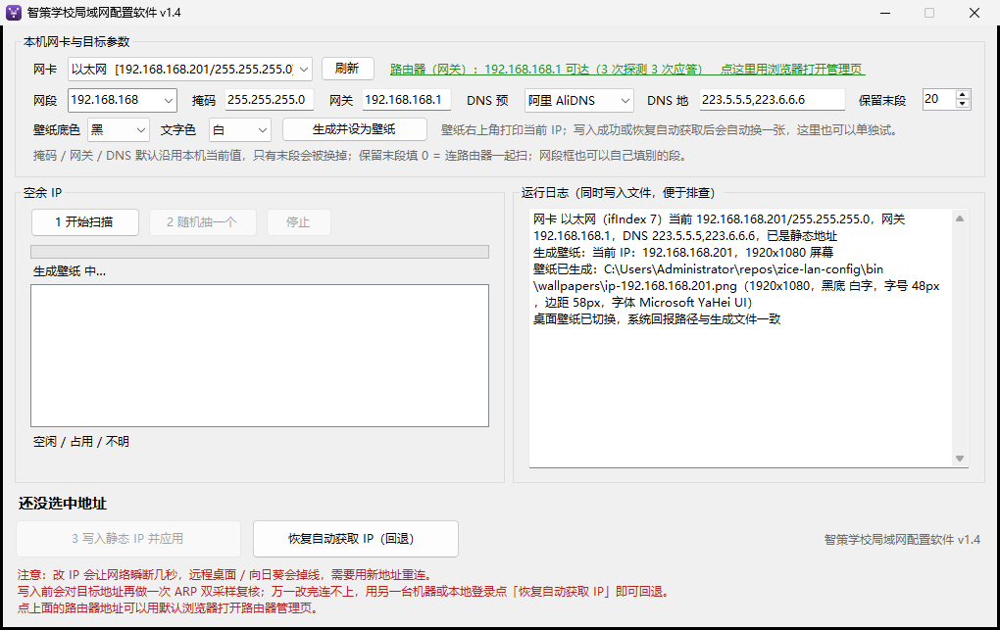
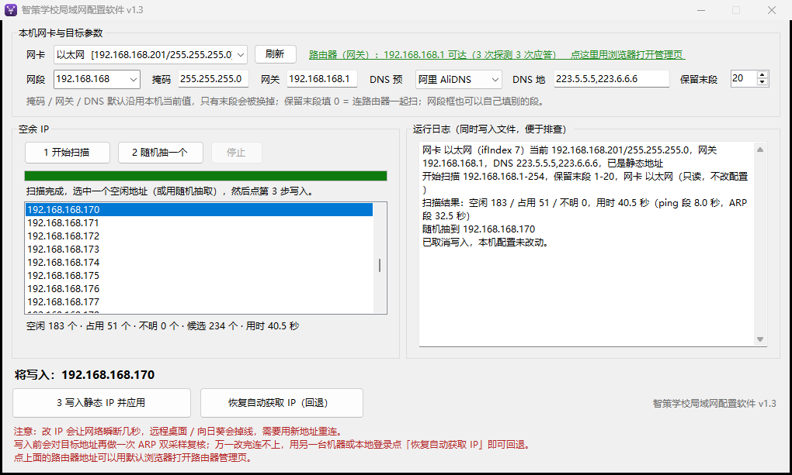
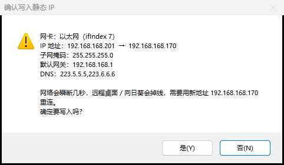
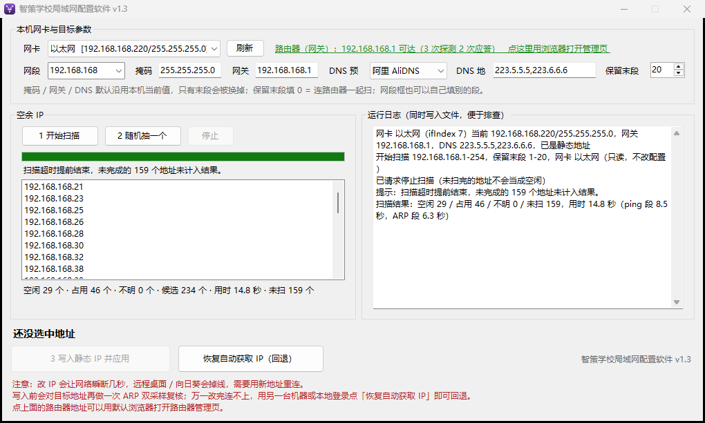

# 智策学校局域网配置软件 v1.0

在 192.168.168.0/24 里找出没人用的 IP，随机抽一个，点确定就写进本机网卡的静态 IP；写完顺手把这台机器的桌面壁纸换成一张**右上角打印当前 IP** 的纯色图，机房里一眼就能认出哪台是哪台。

## 界面









下载：Releases 里的 `智策学校局域网配置软件.exe`（单文件绿色版，需管理员）。

## 桌面壁纸标注 IP

写入静态 IP 成功、或恢复自动获取成功之后，自动换一张桌面壁纸：纯色背景，右上角打印 `当前 IP：192.168.168.201`。默认**黑底白字**，底色和文字色各可下拉选 8 种颜色任意组合；也可以点「生成并设为壁纸」单独出图，不用先改 IP。


自适应规则（同一套公式覆盖各种屏）：

| 屏幕 | 字号 | 边距 |
|---|---|---|
| 3840x2160 | 96px | 115px |
| 2560x1440 | 64px | 77px |
| 1920x1080 | 48px | 58px |
| 1366x768 | 34px | 41px |
| 1080x1920（竖屏） | 27px | 32px |
| 320x240 | 24px（下限区） | 16px（下限） |

- 字号 = 48 × (屏宽/1920)，系数夹在 0.5–3.0、字号夹在 20–160px；边距取该边 3%，最小 16px。
- 文字实测宽度超出可用区时按 10% 逐级缩，直到放得下为止（不会缩破下限）。
- 设置走 `SystemParametersInfo`，**不改你原本的壁纸显示样式**；设完回读系统记录的壁纸路径核对，不一致会如实说明。
- 文件按 IP 命名留在 `wallpapers\ip-<IP>.png`，换过的地址各留一张。
- 壁纸出问题是独立事件：日志会写清楚文件生成在哪、桌面为什么没换成，IP 写入本身仍算成功。

## 与 zc-IPFreeScanner 的关系

同一产品名的另一份实现是 [`openclawzhangchong/zc-IPFreeScanner`](https://github.com/openclawzhangchong/zc-IPFreeScanner)（Python + Tkinter）。本仓库是 C# WinForms 版，已把那边的功能配了过来（网段切换 / 路由器直达 / DNS 预设 / 停止扫描 / 应用图标）。判据与兜底上的差异：

| | 本仓库（C#） | zc-IPFreeScanner（Python） |
|---|---|---|
| 空余判定 | ping + `SendARP` 主动探测 + 系统 ARP 表双路信号 | ping + 系统 ARP 表 |
| 写入前 | 再发 2 次 `SendARP` 复测，有人应答就中止 | 无 |
| 掩码 / 网关 / DNS | 运行时读网卡现值，可编辑 | 写死 `255.255.255.0` + 自动检测网关 |
| 改坏之后 | 「恢复自动获取 IP（DHCP）」一键回退 + 写后回读自检 | 无 |
| 自检 | 42 条出厂闸门 `--selftest`，构建不过不出包 | 无 |
| 整段耗时 | 约 36 秒（分段计时见验证文档） | 约 3~6 秒（判据更薄） |

## 用法

1. 双击 `智策学校局域网配置软件.exe`（需要管理员权限，会自动提权）。
2. 顶部网卡默认选中当前连着目标网段的那块；掩码 / 网关 / DNS 已按本机现值预填，只有「网段末段」会被换掉，想改直接编辑。
3. 「网段」框可下拉切 `192.168.168` / `192.168.200`，也能自己填别的三段前缀；切段时网关会自动跟到该段的 `.1`（你手改过的网关不会被动），同时旧的扫描结果作废、要求重扫。
4. 「DNS 预设」下拉内置 7 家（阿里 / 腾讯 / 114 / 百度 / 360 / 火山 / CNNIC），选完 DNS 框仍可手改；改成不属于任何预设的值，下拉会自动标成「自定义」。
5. 「路由器（网关）」那行启动时会 ping 一次并标可达/暂不可达，点它可以调用默认浏览器打开路由器管理页。
6. 「保留末段 1-20」= 路由器、打印机这类固定地址不参与抽取，填 0 就整段都扫。
7. 点 `1 开始扫描`：并行 ping + `SendARP` 主动探测，再叠上系统 ARP 表现存的主机做第二路信号；列表里给出空闲地址，「占用」是不许碰的，「不明」是探测状态不可信、同样不给你选。中途可点「停止」，没扫完的地址计入「未扫」，绝不混进空闲列表。整段耗时见 `docs\VERIFICATION.md` 的分段计时。
8. 点 `2 随机抽一个`，或在列表里自己选。
9. 点 `3 写入静态 IP 并应用`：确认框里会列出旧值→新值，并再次 ARP 复测该地址仍空才真的下命令；写完自动回读生效值 + ping 网关 3 次，结果显示在窗口和日志里。
10. 改完网络会瞬断几秒，远程桌面 / 向日葵会掉线，要用新地址重连。连不上时用另一台机器或本机登录点 `恢复自动获取 IP（回退）`。

日志落在 exe 同目录 `logs\run-日期.log`（写不进去时退回 `%LOCALAPPDATA%\智策学校局域网配置软件\logs`）。

## 命令行（排查用，不动配置）

```
智策学校局域网配置软件.exe --selftest [--out=文件]   # 57 条纯逻辑闸门，不碰网络也不碰桌面
智策学校局域网配置软件.exe --scan [--out=文件] [--prefix=192.168.168] [--reserve=20] [--adapter=7]
智策学校局域网配置软件.exe --wallpaper [--ip=192.168.168.201] [--size=2560x1440] [--bg=深蓝] [--fg=亮黄] [--no-apply]
智策学校局域网配置软件.exe --version
```

`--scan` 只读，会输出网卡清单、空闲/占用/不明计数（含 `ping_ms` / `arp_ms` 分段计时），并额外用系统 `ping.exe` 复核 3 个空闲地址做交叉验证（有矛盾则返回码 3）。`--wallpaper` 加 `--no-apply` 只出图不动桌面，用来验证各种分辨率下的排版。

## 构建

```
powershell -NoProfile -ExecutionPolicy Bypass -File .\build.ps1
```

用系统自带的 `csc.exe`（.NET Framework 4.x，C# 5 语法上限），产物 `bin\智策学校局域网配置软件.exe`。构建脚本会核对文件属性里的 FileVersion / ProductVersion 并跑 `--selftest`，任一不过直接抛错不出包。

## 已知边界

- 只处理一块网卡的 IPv4；多网卡请分次操作。
- 「空闲」= 当前没人应答，不代表 DHCP 池不会把它发给别人；学校若有 DHCP 服务器，写之前最好确认该地址在保留区外。
- 本机不在 192.168.168 网段时扫不出东西，属正常，换网卡或先接入网络。
